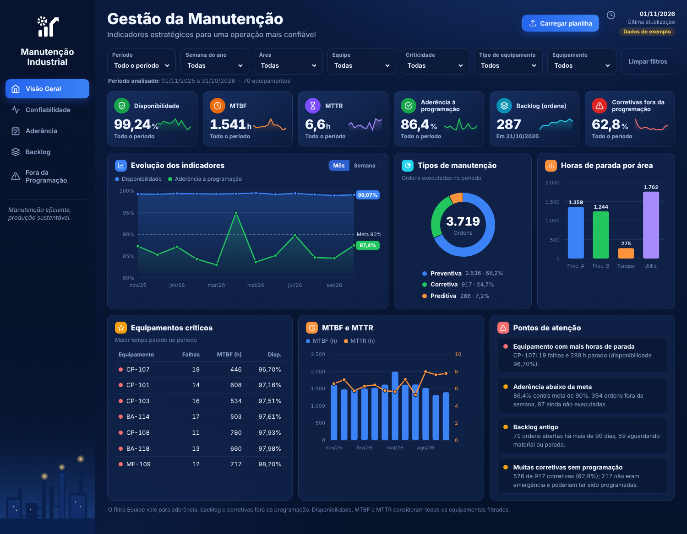
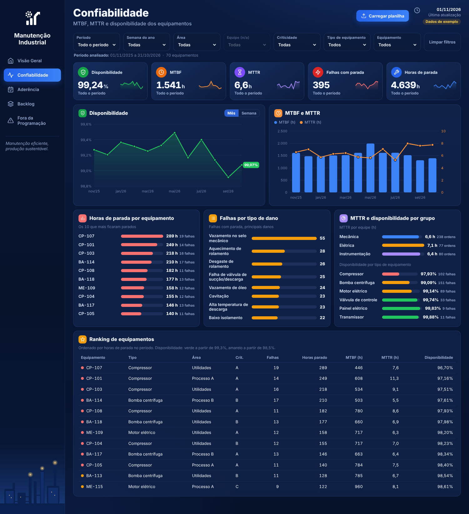
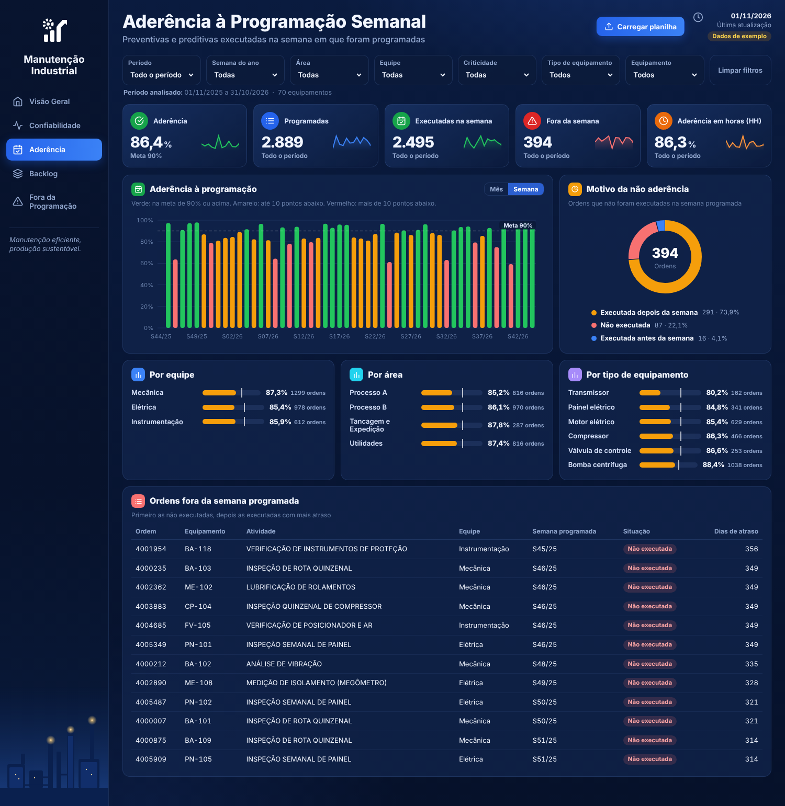

# Painel de Gestão da Manutenção (SAP PM)

Dashboard de indicadores de manutenção construído como projeto de portfólio de analista de manutenção. Calcula **MTBF, MTTR, Disponibilidade, Backlog, Aderência à programação semanal** e **corretivas fora da programação** a partir de uma base no formato SAP PM.

> **Demo online:** https://leonardosilvars.github.io/Gestao-da-Manutencao/painel-manutencao/
> Todos os dados são **fictícios**, gerados para este projeto. Nenhum dado real de empresa é usado.



## O que o painel responde

| Tela | Pergunta de gestão |
|---|---|
| Visão Geral | Como está a planta hoje: disponibilidade, MTBF, MTTR, backlog, aderência e fora da programação |
| Confiabilidade | Quais equipamentos e áreas mais falham ou ficam parados? O reparo está ficando mais lento? |
| Aderência | As preventivas planejadas na semana foram executadas na própria semana? |
| Backlog | Quantas ordens estão abertas, há quanto tempo e aguardando o quê (material, parada)? |
| Fora da programação | De onde vêm as corretivas não programadas e quantas poderiam ter sido planejadas? |

Filtros: período (mês), **semana do ano**, área, equipe, criticidade, tipo de equipamento e equipamento.




## Definições dos indicadores

- **MTTR:** média da duração de execução das corretivas (PM01) com parada de equipamento, no período.
- **MTBF:** (horas de operação − horas de parada) ÷ número de falhas com parada. Horas de operação = equipamentos × 24 h × dias.
- **Disponibilidade:** (horas de operação − horas de parada) ÷ horas de operação.
- **Backlog:** ordens criadas até a data de corte e ainda sem encerramento técnico (TECO) na data.
- **Aderência:** preventivas/preditivas (PM02/PM03) programadas para a semana (segunda a domingo) e **concluídas dentro da mesma semana**, sem tolerância. Meta de referência: 90%.
- **Fora da programação:** corretivas (PM01) sem programação prévia, por origem (emergência, rota de inspeção, solicitação da operação). "Poderiam ser programadas" = fora da programação e origem diferente de emergência.

As fórmulas equivalentes em DAX para Power BI estão em [docs/Medidas_DAX.md](docs/Medidas_DAX.md).

## Como usar

1. Abra `index.html` no navegador (funciona offline, sem servidor nem instalação).
2. O painel abre com **dados de exemplo**. Para analisar outra base, clique em **Carregar planilha** e escolha um `.xlsx` no mesmo formato de `data/Base_Manutencao_SAP_PM.xlsx`.
3. A planilha é lida e recalculada **no próprio navegador**. Nada é enviado a servidor nem gravado; ao recarregar a página, voltam os dados de exemplo.

Abas esperadas na planilha: `Equipamentos`, `Ordens`, `Notificacoes`, `Programacao_Semanal` e, opcionalmente, `Catalogo_Falhas`. As colunas obrigatórias aparecem na janela "Carregar planilha".


## A base de dados fictícia

`data/Base_Manutencao_SAP_PM.xlsx`: 12 meses, 70 equipamentos (bombas, motores, compressores, válvulas, transmissores e painéis) em 4 áreas, 3 equipes (mecânica, elétrica e instrumentação) com 4 técnicos cada, identificados apenas por matrícula. Contém ordens PM01/PM02/PM03, notificações, confirmações de horas, programação semanal, status de usuário (aguardando material/parada) e catálogo de falhas. Gerada de forma reprodutível (semente fixa) por `src/build_base.py` e `src/write_xlsx.py`.

## Estrutura do repositório

```
index.html            painel completo em um único arquivo
data/                 planilha de exemplo (fictícia)
docs/                 medidas DAX e capturas de tela
src/                  código-fonte (engine.js: cálculos, ui.js: telas, import.js: leitura de .xlsx)
```

Para reconstruir o `index.html` a partir de `src/`, ajuste os caminhos no topo de `build.py` e `prepare_data.py` e execute `python prepare_data.py` e depois `python build.py`.

## Tecnologias

HTML, CSS e JavaScript puros (sem bibliotecas), gráficos em SVG desenhados no código, leitor de `.xlsx` próprio. Base de dados gerada em Python (pandas, openpyxl).

## Autor

Leonardo Silva www.linkedin.com/in/leonardosilvars
